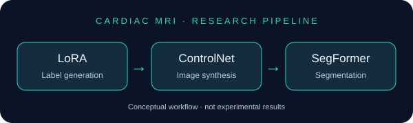
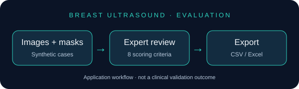

<p align="center"></p>

<h1 align="center">Hi, I'm Halima Fouadi 👋</h1>

<p align="center"><strong>Generative AI · Medical Imaging · Computer Vision</strong></p>

<p align="center">
  <a href="https://github.com/halima-fouadi"></a>
</p>

```python
class AboutMe:
    name = "Halima Fouadi"
    focus = ["Medical AI", "Generative AI", "Computer Vision" ]
    applications = ["Cardiac MRI", "Breast Ultrasound", "Diabetic Retinopathy", "Chest CT", "Breast MRI" ....]
    interests = ["Controllable Diffusion", "Segmentation", "Expert Evaluation", "Classification", "Diagnosis" ]
```

## About my work

My work focuses on artificial intelligence for medical applications, combining deep learning, computer vision, and generative AI. I explore methods for medical image analysis, synthesis, and segmentation, alongside the development and evaluation of AI tools for medical research.

## Professional & research profiles

<p align="center">
  <a href="https://www.linkedin.com/in/halima-fouadi/"></a>
  <a href="https://scholar.google.com.do/citations?user=KiHsbPYAAAAJ&amp;hl=iw"></a>
  <a href="https://www.researchgate.net/profile/Halima-Fouadi"></a>
  <a href="https://orcid.org/0009-0003-0733-9832"></a>
  
</p>

<!-- HAL: add the personal profile link when available. -->

## Featured projects

<table>
<tr>
<td width="50%" valign="top">
<a href="https://github.com/halima-fouadi/CardiacSegDiffusion"></a>
<h3>CardiacSegDiffusion</h3>
<p>Controllable diffusion pipelines supporting transformer-based cardiac MRI segmentation.</p>
<p><strong>Methods:</strong> Stable Diffusion v1.5, LoRA, ControlNet, SegFormer.</p>
<p><strong>Status:</strong> Research overview for peer review; full implementation, models and dataset announced for release upon acceptance.</p>
<a href="https://github.com/halima-fouadi/CardiacSegDiffusion">Explore the project &rarr;</a>
</td>
<td width="50%" valign="top">
<a href="https://github.com/halima-fouadi/clinical-validation-us"></a>
<h3>Synthetic Ultrasound Evaluation</h3>
<p>A Streamlit application for radiologists to evaluate synthetic breast ultrasound images alongside masks and metadata.</p>
<p><strong>Features:</strong> Eight scoring criteria, reviewer progress, CSV/Excel exports and Google Drive backup.</p>
<p><strong>Stack:</strong> Python, Streamlit, pandas, Pillow, Google Drive API.</p>
<a href="https://github.com/halima-fouadi/clinical-validation-us">Explore the project &rarr;</a>
</td>
</tr>
</table>

## 🛠 Programming Languages


## 🧰 Libraries & Frameworks


## 🔧 Tools & Platforms


## 📌 Domains of Expertise


## Explore my work

Browse the linked repositories for project scope, implementation availability, and technical details.
